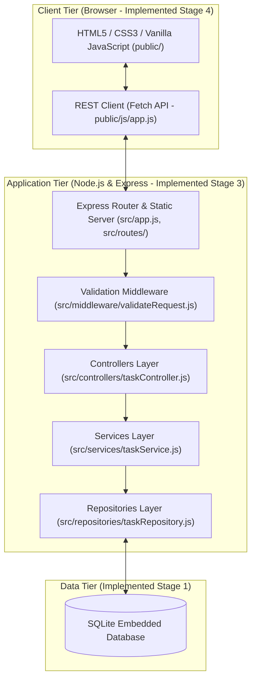
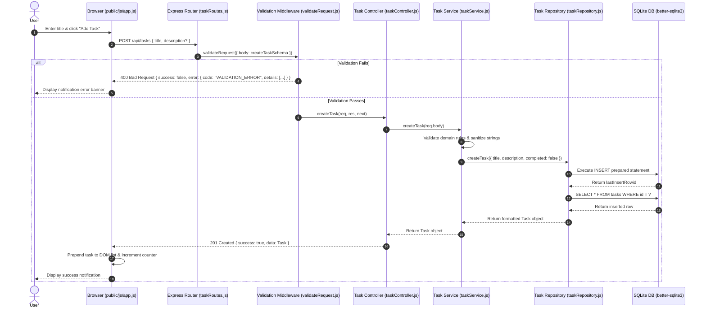

# High-Level Design (HLD) - TaskFlow Lite

## 1. System Architecture

TaskFlow Lite adheres to a clean, layered monolithic architecture executing within a single Node.js runtime process.

---

## 2. Component Responsibilities

### 2.1 Client Tier (Public Assets - Implemented Stage 4)
- **HTML (`public/index.html`):** Semantic, accessible markup for task creation, filter tabs (All / Pending / Completed), and the task list.
- **CSS (`public/css/styles.css`):** Responsive stylesheet with clear visual hierarchy, accessible color contrasts, and focus rings.
- **JavaScript (`public/js/app.js`):** Vanilla JS handling user interactions, DOM updates (safe textContent construction), inline editing, and asynchronous fetch calls.

### 2.2 Application Tier (Express Backend - Implemented Stage 3)
- **Server Startup (`src/server.js`):** Reads `PORT` (default 3000), initializes persistent SQLite database, binds listener, and orchestrates graceful SIGINT/SIGTERM shutdown.
- **Express App Configuration (`src/app.js`):** Configures JSON body parser, serves static assets from `public/`, mounts `/api/health` and `/api/tasks`, mounts 404 handler, and registers centralized error handler. Supports dependency injection of `TaskService`.
- **Routes (`src/routes/taskRoutes.js`):** Declarative route routing for `POST /`, `GET /`, `GET /:id`, `PATCH /:id`, `DELETE /:id` bound to validation middleware.
- **Validation Schemas (`src/validators/taskSchemas.js`):** Zod schemas for task creation, updates, completion filter queries, and route parameter IDs.
- **Validation Middleware (`src/middleware/validateRequest.js`):** Intercepts requests, validates body/query/params, coerces values (Express 5 compatible), and formats structured 400 responses.
- **Controllers (`src/controllers/taskController.js`):** Extracts parameters, calls `TaskService`, and maps output to uniform `{ success: true, data }` responses.
- **Services (`src/services/taskService.js`):** Domain rules, sanitization, empty update guards, and repository delegation.
- **Centralized Error Handling (`src/middleware/errorHandler.js`):** Formats client/validation errors and returns a generic 500 for unexpected exceptions without leaking stack traces. Also handles 404 for unmatched routes.

### 2.3 Data Tier (SQLite - Implemented Stage 1)
- Local file database (`data/taskflow.db`) with WAL journal mode for development, and in-memory (`:memory:`) databases for automated testing.
- Table: `tasks` (`id`, `title`, `description`, `completed`, `created_at`, `updated_at`).

---

## 3. End-to-End Request Flow

### 3.1 Task Creation Lifecycle

---

## 4. Database Overview

- **Storage Engine:** SQLite 3 via `better-sqlite3`.
- **Safety Pragmas:** `PRAGMA foreign_keys = ON;`, `PRAGMA journal_mode = WAL;`, `PRAGMA synchronous = NORMAL;` (file mode).
- **Timestamps:** ISO 8601 strings (`new Date().toISOString()`) written by application repository, with `DATETIME('now')` fallback at table level.
- **Booleans:** Stored as `INTEGER` (`0` or `1`), normalized to JavaScript `boolean` (`false` or `true`) by repository.
